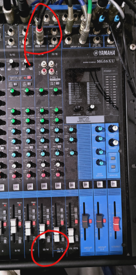
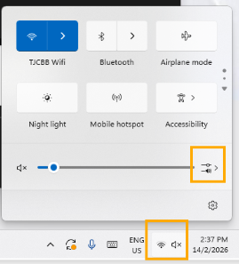
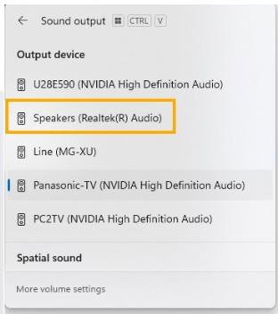
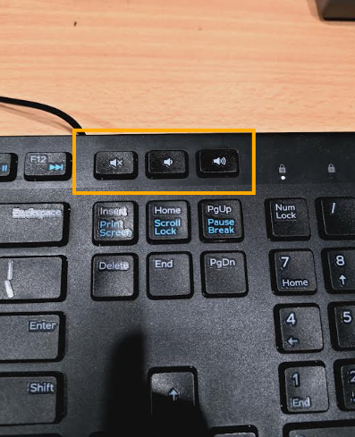
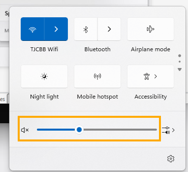

1. First, look at the PA system
2. Check which slot has the thing above plugged in
3. Refer to the picture below, slot 13/14 has the thing plugged in
4.  
5. At the system tray, select SPEAKER
6. 
7. 
8. Reminder, you can use keywbord button to adjust volume, refer picture below
9. 
10. Clicking here will cause the PC to output a loud system sound which will disturb audience. Refer picture below.

    
